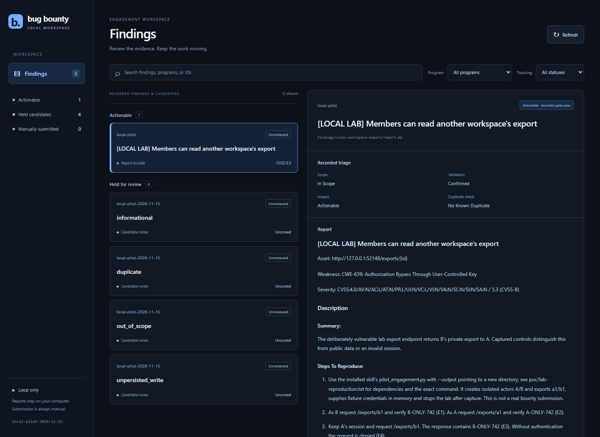

# Codex bug bounty toolkit

An installed Codex skill plus executable engagement tools and a researcher-focused HackerOne MCP server. It supports advisory, assisted, autonomous and mixed work while preserving the active Codex/Daybreak permissions, program rules and the user's report contract.



## Start here

For guided setup from a checkout, run `powershell -NoProfile -ExecutionPolicy Bypass -File ./install.ps1` on Windows, or `sh ./install.sh` on Linux/macOS. The native entry point detects/bootstrap runtimes, then guides agent selection, optional HackerOne MCP, local hidden credential entry and optional browser setup. Existing registrations require replacement consent and are backed up. See the [installer guide](installer/README.md).

Install the latest release interactively:

```powershell
irm https://github.com/imattas/codex-bug-bounty-toolkit/releases/latest/download/install.ps1 | iex
```

```sh
curl -fsSL https://github.com/imattas/codex-bug-bounty-toolkit/releases/latest/download/install.sh | sh
```

Release installers verify the tagged source archive's embedded SHA-256 before setup.

## Local WebUI

The installer offers the dashboard by default and creates **Open Bug Bounty Dashboard** launchers. It works independently of HackerOne MCP and needs no frontend build tools. Choose your engagement directory once during setup, then use the launcher to open findings, search/filter programs, read reports, preview verified PoC/evidence and track review status.

For a checkout:

```powershell
hackerone-mcp/.venv/Scripts/python -B bug-bounty/scripts/webui.py --root engagements --open
```

The UI binds to `127.0.0.1`, chooses another port if 8765 is occupied, and keeps manual tracking separate from report eligibility. It never submits reports or changes triage gates. See the [dashboard guide](bug-bounty/references/webui.md).

The skill is in [bug-bounty/SKILL.md](bug-bounty/SKILL.md). The installed copy is under `~/.codex/skills/bug-bounty`. Invoke `$bug-bounty` with a program/policy, supplied evidence or a repository. Start at the relevant stage rather than automatically scanning.

This development workspace has a local MCP registration in `.codex/config.toml`, pointing at the isolated environment in `hackerone-mcp/.venv`; it is excluded from release packages. The [portable config example](hackerone-mcp/codex-config.example.toml) and interactive installer generate paths for a new machine. Local calculation/inventory tools need no HackerOne credentials. Filesystem and execution tools are confined to the configured engagement directory. Setup does not change Daybreak access, approval policy or sandbox settings.

HackerOne reads require `H1_USERNAME` and `H1_API_TOKEN` in the environment of the process launching Codex. Set them locally, not in chat or committed configuration. Use a researcher API token for the Hacker API. The server never accepts tokens as tool arguments. No account has been connected or live API verified during this build.

## Run the pilot

In this prepared workspace:

```powershell
hackerone-mcp/.venv/Scripts/python -B bug-bounty/scripts/pilot_engagement.py --output engagements/my-first-local-pilot
```

Use a new output directory. The fixture binds only to loopback, runs eight controlled requests and stops afterward. It creates one clearly labeled lab finding and retains rejected informational, duplicate, out-of-scope and non-persisted-write candidates as notes. The [pilot guide](bug-bounty/references/pilot-engagement.md) explains its output. Retained development runs under `artifacts/` are excluded from releases; none is a real bounty submission.

## Reports

Only confirmed, actionable, eligible findings with a completed accessible-source duplicate check are rendered:

```text
findings/<root-cause-slug>/
  report.md
  poc/
  evidence/
```

The exact user-supplied frame includes Asset, primary Weakness, calculated CVSS 4.0, Description/Summary, numbered reproduction, expected/actual behavior, supporting material and Impact. Rejected or unresolved items stay outside findings. Start from [candidate assessment](bug-bounty/assets/candidate-assessment.json); see [bundle workflow](bug-bounty/references/finding-bundles.md).

## Tools that execute

The [execution runtime](bug-bounty/references/execution-runtime.md) implements SQLite-backed shared request/time/rate/concurrency budgets, exact-origin/path allowlists, credential references, per-identity HTTP cookies, bounded retries/timeouts/response capture and redaction. All retries count against the same budget. State-changing requests need explicit authorization and `allow_write`; an allowlist is not evidence of program permission.

The optional real Chromium adapter creates a separate nonpersistent browser context per actor, preserves browser protections and restricts network traffic. Screenshots support explicit masks and require visual/secret review. The browser binary and Python dependency are installed separately; the adapter never downloads them while running a task.

MCP local tools expose these operations as `bugbounty_budget_init/status`, `bugbounty_http_replay`, `bugbounty_browser_capture`, `bugbounty_score_cvss`, `bugbounty_openapi_inventory`, `bugbounty_local_duplicate_candidates`, `bugbounty_create_finding` and `bugbounty_run_pilot`.

## HackerOne integration

See [server setup and capabilities](hackerone-mcp/README.md). It uses the official MCP SDK and documented researcher API: program policy, structured scopes, exclusions, weaknesses, own reports and disclosed activity. Search is local with source, freshness and pagination coverage; it cannot search all private duplicate reports.

Submission is a separate prepare/review/commit operation. The exact payload, bundle hashes and program mapping are persisted. Commit revalidates them and claims the send before one POST. Ambiguous outcomes are held for reconciliation, never blindly retried. Writes are disabled in this workspace's config. PoC/evidence are local artifacts; the reviewed Markdown must be self-contained because this server does not upload attachments. No financial or program-administration actions are exposed.

## Recreate the environment elsewhere

Manual setup uses standard, GIL-enabled CPython 3.11+. The native installers detect a compatible runtime and offer managed Python when needed:

```powershell
python -m venv hackerone-mcp/.venv
hackerone-mcp/.venv/Scripts/python -m pip install -e ./hackerone-mcp -r bug-bounty/scripts/requirements-cvss.txt -r bug-bounty/scripts/requirements-browser.txt
hackerone-mcp/.venv/Scripts/python -m playwright install chromium
```

On POSIX use `.venv/bin/python`. Browser installation is optional for HTTP/scoring/MCP research. Update the interpreter, project/data/skill paths in the Codex config example; paths in this workspace's active config are machine-specific. Keep all cache and engagement records private.

## Verify

```powershell
hackerone-mcp/.venv/Scripts/python -B -m unittest discover -s bug-bounty/tests -v
hackerone-mcp/.venv/Scripts/python -B -m unittest discover -s hackerone-mcp/tests -v
```

For real-browser tests set `BUG_BOUNTY_REAL_BROWSER=1` and point `PLAYWRIGHT_BROWSERS_PATH` at the installed browser directory if nondefault. Tests use loopback fixtures, SQLite, the real MCP SDK/stdio transport and mocked HackerOne HTTP responses. Live credential validity and live submissions are not asserted by offline tests.
